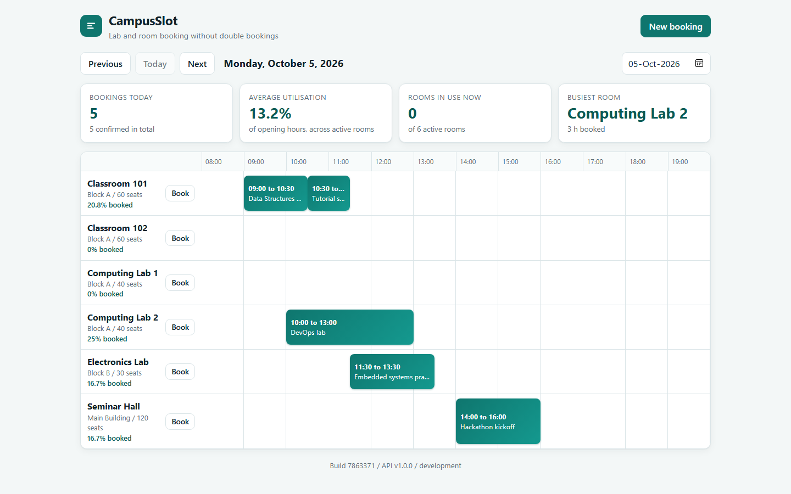

# CampusSlot

[](https://github.com/Ujjwaljain16/campusslot/actions/workflows/ci-cd.yml)

**A room-booking service that I use to build and operate a production-style delivery platform: signed releases, GitOps, canary rollouts that judge themselves, an operator-run database, policy at admission, and traces linked to metrics and logs. Every claim below was measured, and the transcript is in the repository.**



## What this is

CampusSlot lets people reserve a room for a time slot, and guarantees that two confirmed bookings can never overlap. The application is small on purpose (FastAPI, React, PostgreSQL, no login), so that the effort goes into how it is built, shipped, secured, observed and broken on purpose.

It has two versions:

- **v1** (`main`, tag `v1.0-capstone`) is the first version. I built it as the final project of a DevOps and cloud course, and it is frozen. Its full walkthrough is the [build log](docs/build-log.md).
- **v2** (this branch) is what I added afterwards to bring the same system closer to production practice: progressive delivery, a replicated database with point-in-time recovery, admission policy, environments with promotion rules, linked observability and a game day. It is not merged into `main` yet.

There are no real users. This is a portfolio and learning project, and it ran on a laptop, on throw-away [kind](https://kind.sigs.k8s.io/) clusters in GitHub Actions, and once on a short-lived EKS cluster that I destroyed.

## What v2 shows

I wrote a prediction for every drill before running it, ran it, and kept the difference. Where a prediction was wrong, the document says so.

| Capability | Measured result | Details |
|---|---|---|
| Canary releases judged by the SLO | The same bad release (a ready pod that fails 30 % of its requests) failed **535 of 1,800 requests on a plain Deployment and 27 with a canary, 95 % fewer**. The rollout aborted itself in 79 s while the canary still had 10 % of the traffic | [canary releases](docs/engineering/canary-releases.md) |
| Database failover and recovery | The primary was killed under load: a replica took over in about 20 s, and **0 of 961 acknowledged writes were lost** across four runs. A restore to a chosen point in time returned **709 of 709 rows in 53 s** | [database reliability](docs/engineering/database-reliability.md) |
| Policy at admission | Default-deny network policies: 2 of 6 connection checks passed before, **6 of 6 after**, and the application kept working. Kyverno refused an image without a signed build attestation, and a built-in CEL policy refused off-registry and untagged images | [admission and network policy](docs/engineering/admission-and-network-policy.md) |
| Environments and promotion | A build reached dev in 62 s and staging 35 s after its own promotion. A promotion that skips an environment is refused by rules that run in CI. A manual scale and a deleted Service were undone in 2 s | [environments and promotion](docs/engineering/environments-and-promotion.md) |
| Linked signals | One slow request followed from the metric to its trace to its log line, by trace id alone: **412 of 415 ms were spent outside the database** | [linked signals](docs/engineering/linked-signals.md) |
| Game day | Six failure scenarios under steady load (pod, database pod, database primary, bad release, slow release, node drain), each judged against a written hypothesis. All passed, with no acknowledged write lost | [game day](docs/engineering/game-day.md) |
| The cost of tracing | I predicted a few percent. It measured **+15 to +18 % p95 at 10 % sampling and +53 to +61 % at full sampling**, under a saturating load. Tracing is off by default | [game day](docs/engineering/game-day.md) |

The drills ran on GitHub-hosted runners, so the numbers are those of a shared 4 vCPU machine with a one-node kind cluster. They show behaviour (what is refused, what is undone, how long a takeover takes), not the capacity of a production cluster.

## What v1 shows

| Area | Result |
|---|---|
| Correctness | Overlapping bookings are impossible in three layers (validation, an application check, and a PostgreSQL `EXCLUDE` constraint on `tstzrange`), each tested. 60 backend tests, 7 on a real PostgreSQL including a concurrent race, 12 frontend tests, coverage floor 85 % |
| Pipeline | GitHub Actions: lint, tests, dependency audits, secret scan, Terraform and Helm static analysis, Trivy gate, signed provenance and SBOM verified before every deploy, a Helm deploy to kind with a smoke test. Median 148 s from push to deployed |
| Bad release | `helm upgrade --atomic` rolled a release that never became ready back by itself in about 62 s, with **0 of 4800 user requests failed** |
| Rolling updates | 8 of 8 measured rollouts lost 1 or 2 requests, although the chart allows no unavailable pods. After an 8 s `preStop` delay, 6 of 6 lost none |
| Data growth | A GiST range index made the overlap query cost flat (30 pages) from 1 thousand to 200 thousand rows, against 2469 pages before |
| Infrastructure | Terraform built a VPC and an EKS cluster (48 resources), applied for real and destroyed again, for about 6 US cents |
| Observability | Prometheus metrics, Loki logs and two SLOs with burn-rate alerts and runbooks. In a drill the alert fired after 185 s and resolved 52 s after the fix |

The v1 details, with the failures along the way, are in the [build log](docs/build-log.md) and in [`docs/engineering`](docs/engineering).

## Architecture

```
  Browser
     |
  Ingress (nginx) ---- weight 10 -> 50 -> 100 ----+
     |                                            |
  frontend (nginx, non-root)             canary Service (new pods)
     |  /api                              stable Service (old pods)
     v                                            |
  backend (FastAPI, Argo Rollout) <---------------+   metrics of the canary pods only
     |   |                                              judged by an AnalysisTemplate (Prometheus)
     |   +--- traces (OTLP) ---> Tempo ---+
     |   +--- JSON logs ---> Alloy ---> Loki ---+----> Grafana  (metric -> trace -> log by trace id)
     |   +--- /metrics ---> Prometheus -----------+
     v
  PostgreSQL (CloudNativePG: primary + replica, failover, WAL archive to an object store)

  git push -> GitHub Actions -> tests, scans, signed images -> GHCR (tag = commit SHA)
  gitops/envs/{dev,staging,prod} -> Argo CD ApplicationSet -> one namespace per environment
  admission: Kubernetes CEL policy + Kyverno attestation check + default-deny NetworkPolicies
  Terraform -> VPC + EKS (shown once, then destroyed)
```

Four decisions shape it:

- **Liveness and readiness are different questions.** `/health` never touches the database, so a database outage cannot restart pods. `/ready` does, so a pod without a database gets no traffic.
- **A release is judged by what users experience.** A canary receives a share of the traffic, and its own error ratio and latency decide whether it continues or is aborted.
- **Promotion is a commit with rules.** Staging takes only what dev runs, prod only what staging runs, and the rules are tested and enforced on every pull request.
- **Nothing secret is in Git.** Passwords live in Secrets created at install time, and images are only run if CI built and attested them.

## How I test it

Each drill is a script plus a document with the prediction written first. The drills run as jobs of [`.github/workflows/drills.yml`](.github/workflows/drills.yml) on a kind cluster that exists for the length of the job, so none of it needs a laptop cluster:

```bash
git push -f origin v2:refs/heads/drill/phase1     # canary; phase2 policies, phase3 database,
                                                  # phase4 linked signals, phase5 environments, phase6 game day
gh run download <run-id>                          # the transcripts come back as artifacts
```

The transcripts are in [`docs/evidence/v2`](docs/evidence/v2). Several first runs were wrong, and the documents keep that: a green job once hid a drill that never ran, a canary aborted a bad release at 50 percent of the traffic because its first pause was shorter than its own analysis (lengthened, and the drill repeated), a test pod was refused for the wrong reason, and a game day harness reported a recovery of 0.1 s because it looked at a pod that was still terminating. [Running the drills](docs/v2/RUNNING-THE-DRILLS.md) describes the method.

## Run it

Without Docker, against SQLite:

```bash
cd backend && pip install -r requirements-dev.txt
DATABASE_URL=sqlite:///./local.db alembic upgrade head
DATABASE_URL=sqlite:///./local.db uvicorn app.main:app --port 8000
cd ../frontend && npm ci && npm run dev          # http://localhost:5173
```

With Docker Compose (PostgreSQL included):

```bash
cp .env.example .env        # put a random password in .env, which is git-ignored
docker compose up --build -d                     # http://localhost:3000
```

On Kubernetes, with the images that CI built for a commit:

```bash
minikube start -p campusslot --memory=3500 --cpus=3 --addons=ingress,metrics-server
scripts/install-monitoring.sh && scripts/deploy-local.sh <commit-sha>
ROLLOUT=1 scripts/deploy-local.sh <commit-sha>   # as a canary rollout (after scripts/install-rollouts.sh)
```

The tests:

```bash
cd backend && pytest --cov=app --cov-fail-under=85          # 60 tests on SQLite
POSTGRES_TEST_URL=postgresql+psycopg://... pytest -m postgres   # 7 tests on a real PostgreSQL
cd frontend && npm test
python -m unittest discover -s scripts/tests                # 46 tests of the promotion rules and the game day
```

## Repository map

```
backend/        FastAPI app, Alembic migrations, tests, tracing, fault switch for drills
frontend/       React 19 and Vite app, nginx config
helm/           The chart: Deployment or Argo Rollout, CloudNativePG cluster, network policies, alert rules
gitops/         One values file per environment, the ApplicationSet, Argo CD values
policies/       Admission policy (CEL) and the Kyverno attestation policy
monitoring/     Prometheus, Loki, Alloy and Tempo values, Grafana dashboards
terraform/      VPC and EKS
scripts/        Installers, drill scripts, the promotion tool, the game day orchestrator, tests
ci/, k8s/       kind cluster configurations, namespaces
docs/           engineering/ (measured decisions), adr/ (20 decision records), runbooks/, evidence/, v2/, build-log.md
.github/        The pipeline, the drills, the promotion workflow
```

## Decisions and write-ups

- [20 decision records](docs/adr/README.md): the options, the choice, the consequences, and what I would do in production.
- [`docs/engineering`](docs/engineering): one measured write-up per topic (canary, database, policies, tracing, promotion, game day, performance, sizing, supply chain, resilience, SLOs, and more).
- [Runbooks](docs/runbooks/README.md) for every alert.
- [v2 status table](docs/v2/README.md): each phase, what it claims, and what was measured.

## Known limits

Stated plainly, because they are part of the result:

- **All drills ran on kind clusters on shared GitHub runners.** A node is a container, the volumes are local, and a drain is gentle compared with a lost machine. The results show that the defences work there, not how long a real node loss takes.
- **Production was declared, rendered and tested in CI, and never deployed.** The `Promote` workflow, which opens the promotion pull request, has not run, because a workflow has to be on the default branch to be started by hand.
- **Synchronous and asynchronous replication could not be told apart.** Both lost no writes under the load of the drills. That synchronous replication prevents the loss is the design of the setting, not something these runs proved.
- **Argo CD undoes what Git declares and not what Git does not mention.** A value that was changed by hand was put back in 2 s, and an environment variable added by hand stayed while the application reported `Synced`. A remedy (server-side diff, or an admission rule) is not built.
- **Tracing is expensive under saturation** and the instrumentation is not optimised. It stays off by default.
- **The Kyverno policy uses `ClusterPolicy`,** which Kyverno marks deprecated in favour of `ImageValidatingPolicy`. It works on the version that ran.
- **The Tempo chart (single binary) is deprecated** and works. A production setup would use the distributed chart.
- **The application has no authentication.** I left it out on purpose, because it would add code without adding to the delivery story.
- **Alerts reach nobody:** there is no Alertmanager, so an alert is visible in Prometheus only.
- **EKS ran for under an hour and carried no workload.**

## History

The first version was my final project for a DevOps and cloud course (module 20). It was submitted from `main`, which is kept as it was submitted, with the tag `v1.0-capstone`. Everything after that is v2.
